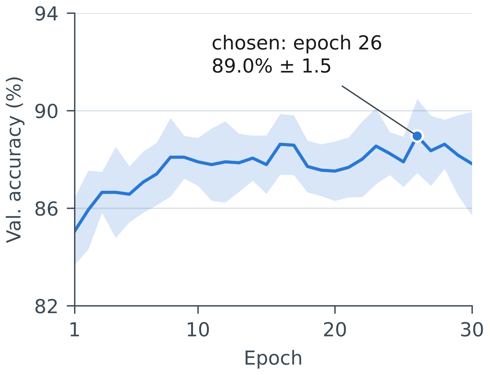

# Skin Cancer Classification: Malignant or Benign

A transfer-learning classifier that labels dermoscopic skin-lesion images as **malignant** or **benign**, using a frozen ImageNet ResNet50 and a small trained classification head. Started as the Machine Learning Zoomcamp (DataTalks.Club, 2026) capstone, then re-evaluated with a leak-free protocol (v5).

**Result (v5):** 89.8% accuracy on 636 held-out test images (95% CI 87.4–92.0%), with 92.6% sensitivity and ROC AUC 0.957. The test set was scored once, after all choices were made on training data.

> Educational research project, not a medical device. For diagnosis, consult a qualified healthcare professional.

## Problem statement

Millions of people each year find a new spot on their skin and need to know whether it is malignant or benign. Biopsy is the gold standard, but the first decision to refer is visual, and many regions, including much of rural Arkansas, have few dermatologists. Convolutional neural networks can reach dermatologist-level accuracy on lesion images, so a low-cost image classifier could support earlier referral where specialists are scarce.

## Results

| Model | Evaluation | Accuracy | Notes |
|---|---|---|---|
| **v5 (current)** | Test set used once, n = 636 | **89.8%** (95% CI 87.4–92.0) | Settings chosen by 5-fold CV on training data |
| v5 | 5-fold CV, training set | 89.0% ± 1.5 | Agrees with the test result |
| v4 large | Test set, n = 660 | 90.6% | Dropout and epoch count were tuned on the test set, so this figure is optimistic |
| v3 | Test set, n = 660 | 90.2% | Same caveat as v4 |

v5 on the 636 clean test images:

| Metric | Value (95% bootstrap CI) |
|---|---|
| Accuracy | 89.8% (87.4–92.0) |
| Sensitivity (malignant recall) | 92.6% (89.4–95.4) |
| Specificity | 87.6% (84.0–90.8) |
| Positive predictive value | 85.6% |
| ROC AUC | 0.957 (0.944–0.970) |

Confusion matrix (rows = true class, columns = predicted):

| | Predicted benign | Predicted malignant |
|---|---|---|
| **Benign** | 310 | 44 |
| **Malignant** | 21 | 261 |



## What changed in v5

1. **Duplicate lesions removed from the test set.** A perceptual-hash search, with every candidate pair checked by eye, found 24 test images that show the same lesion as a training image. They were excluded, leaving 636 test images. Look-alike pairs that were different lesions were kept.
2. **Model selection on training data only.** Learning rate (0.01, 0.001, 0.0001), dropout (0, 0.2, 0.5, 0.8) and epochs (1–30) were chosen by 5-fold stratified group cross-validation. Near-duplicate training images were grouped so a lesion never sat on both sides of a split. The choice was learning rate 0.001, dropout 0.2, 26 epochs, the same learning rate and dropout v4 used.
3. **Test set scored once**, after retraining the chosen configuration on all training images.

Full details and code: [`v5_retrain/`](v5_retrain/).

## Data

[Skin Cancer: Malignant vs. Benign](https://www.kaggle.com/datasets/fanconic/skin-cancer-malignant-vs-benign) (Kaggle, ISIC-derived), 224×224 RGB dermoscopic images.

| Split | Benign | Malignant | Total |
|---|---|---|---|
| Train | 1,440 | 1,197 | 2,637 |
| Test (original) | 360 | 300 | 660 |
| Test (v5, de-duplicated) | 354 | 282 | 636 |

## Model

```
Input (224×224×3)
    ↓
ResNet50, ImageNet weights, frozen (~23.6M parameters)
    ↓
Global average pooling (2048)
    ↓
Dense (100, ReLU)
    ↓
Dropout (0.2)
    ↓
Dense (2) → softmax → benign / malignant
```

- Trainable parameters: about 205K (the head only), so training is practical on CPU.
- Optimizer: Adam, learning rate 0.001, batch size 32.
- Loss: categorical cross-entropy on logits.
- Augmentation: shear (10°), zoom (±10%), horizontal flip.

## Using the v5 model

Because the ResNet50 base is frozen, it is identical to Keras's standard ImageNet ResNet50. Only the head's weights are stored, in `v5_head_weights.npz` (0.8 MB, plain NumPy, works with Keras 2 and 3). `load_v5.py` rebuilds the full model:

```bash
python load_v5.py data/test/malignant/1.jpg
# benign 0.000  malignant 1.000
```

```python
from load_v5 import load_v5
model = load_v5("v5_head_weights.npz")   # outputs logits; apply softmax for probabilities
```

## Reproducing v5

Requires the `data/` images and `ResNet_v4_large_15_0.906.h5` (its frozen base is reused). Run from the repository root:

```bash
python v5_retrain/dupcheck.py .                                        # train/test near-duplicates -> dups.json
python v5_retrain/features.py . feat.npz 4                             # ResNet50 features, original + 4 augmented views
python v5_retrain/train_eval.py . feat.npz dups.json out/              # 5-fold group CV, then one test evaluation
python v5_retrain/verify_v5.py . out/ResNet_v5_cv_26_0.898.keras out/results_v5.json   # re-check on raw images
```

Feature extraction takes about 12 minutes on 2 CPU cores, and the cross-validated search about 25 minutes. Results are saved in [`v5_retrain/results_v5.json`](v5_retrain/results_v5.json).

## Repository structure

```
SkinCancerCapstone/
├── 07-neural-nets-train.ipynb     # Original training notebook (v1–v4)
├── 07-neural-nets-test.ipynb      # Original evaluation notebook
├── kaggle_nb/                     # Same training run on Kaggle GPUs
├── v5_retrain/                    # Leak-free re-evaluation: scripts, results, CV figure
├── v5_head_weights.npz            # v5 model (head weights)
├── load_v5.py                     # Rebuilds the full v5 model
├── ResNet_v4_large_15_0.906.h5    # v4 model (used by the deployments below)
├── ResNet_v3_12_0.902.h5          # v3 model
├── data/                          # Train/test images (Git LFS)
├── model-conversion/              # H5 → Keras / SavedModel → ONNX converters
├── lambdaAWS/                     # AWS Lambda deployment (ONNX)
├── tfserving/                     # TensorFlow Serving / Kubernetes files
├── resnet_v1_*.svg                # Early learning-rate experiments
└── Tracking                       # Experiment log
```

## Deployment

The deployments below were built with the **v4** model; they have not yet been rebuilt with v5.

- **Local:** Docker container from `lambdaAWS/dockerfile`; `lambdaAWS/test.py` sends a request.
- **AWS Lambda:** `lambda_function.py`, `requirements.txt` and the ONNX model, pushed as a container image to ECR and exposed through API Gateway. Steps below.
- **Kubernetes:** TensorFlow Serving, built in a separate Codespace; supporting files in `tfserving/`. See the [Zoomcamp Kubernetes workshop](https://github.com/alexeygrigorev/workshops/tree/main/mlzoomcamp-k8s) and the [TF Serving guide](https://github.com/DataTalksClub/machine-learning-zoomcamp/blob/master/10-kubernetes/07-kubernetes-tf-serving.md).

### Model conversion

`model-conversion/` holds Dockerfiles to convert H5 to Keras or SavedModel. For ONNX, put the Keras model in `model-conversion/to_Onnx/models` and use the Dockerfile in `model-conversion/to_Onnx`. Conversions fill a Codespace's disk quickly; this clears space:

```bash
docker system prune -a --volumes -f
```

### AWS Lambda steps

Create an ECR repository and push the image (replace `my-app`, the account ID and the region; I used `scmodelonnx`):

```bash
# 1. Authenticate
aws ecr get-login-password --region us-east-1 | docker login --username AWS --password-stdin 123456789012.dkr.ecr.us-east-1.amazonaws.com
# 2. Create repository (if needed)
aws ecr create-repository --repository-name my-app --region us-east-1
# 3. Tag the image
docker tag my-app:latest 123456789012.dkr.ecr.us-east-1.amazonaws.com/my-app:latest
# 4. Push to ECR
docker push 123456789012.dkr.ecr.us-east-1.amazonaws.com/my-app:latest
```

Then create a Lambda function from the container image and test it with:

```json
{"url": "https://github.com/jg5xraydelta/SkinCancerCapstone/blob/main/data/test/malignant/1.jpg?raw=true"}
```

To serve it as a web service, put an API Gateway in front of the function ([video walkthrough](https://www.youtube.com/watch?v=wyZ9aqQOXvs&list=PL3MmuxUbc_hIhxl5Ji8t4O6lPAOpHaCLR)). Workshop reference: [Zoomcamp serverless workshop](https://github.com/DataTalksClub/machine-learning-zoomcamp/tree/master/09-serverless/workshop).

## Development notes

- **Environment:** built in GitHub Codespaces. `.devcontainer/devcontainer.json` adds Docker-in-Docker; a new Codespace from this repo picks it up automatically (if `docker --version` fails, rebuild the Codespace). The root is `/workspaces/SkinCancerCapstone`; run `uv sync` to set up the environment. Note that the v4 and v5 models were saved with Keras 3 (TensorFlow 2.18+), newer than the `tensorflow==2.15.0` pin in `pyproject.toml`.
- **Git LFS:** images and model files (`*.jpg`, `*.h5`, `*.keras`, `*.onnx`) are tracked by Git LFS through `.gitattributes`. LFS files must be pushed with git from the command line; GitHub's browser upload page does not handle them. If a large file was committed before LFS tracking, unstage it and remove it from the index (`git rm --cached`) before committing again.
- **Kaggle:** `kaggle_nb/` has the notebook run on Kaggle GPUs (data uploaded as `skin-dataset`, under `/kaggle/input`). It was about 10× faster but no more accurate than CPU training in Codespaces.

## Citation

If you use this work, please cite the poster and code records on Zenodo (DOIs to be added).

## License

Code: MIT License (see `LICENSE`).

## Acknowledgments

- Dataset: C. Fanconi, [Skin Cancer: Malignant vs. Benign](https://www.kaggle.com/datasets/fanconic/skin-cancer-malignant-vs-benign), Kaggle.
- ResNet50: He et al., "Deep residual learning for image recognition," CVPR 2016; weights from Keras Applications.
- Machine Learning Zoomcamp, DataTalks.Club.
- Code drafting and conversion scripts were developed with help from Claude (claude.ai).

## Contact

Jared Gavin, Department of Mathematics and Physics, University of Arkansas at Monticello. Questions or feedback: open an issue on GitHub.
